🌐 **Езици:** [English](../README.md) | [Español](README.es.md) | [Français](README.fr.md) | [Deutsch](README.de.md) | [Português](README.pt.md) | [日本語](README.ja.md) | [简体中文](README.zh-CN.md) | [繁體中文](README.zh-TW.md) | [한국어](README.ko.md) | [العربية](README.ar.md) | [Русский](README.ru.md) | [Italiano](README.it.md) | [Nederlands](README.nl.md) | [Polski](README.pl.md) | [Türkçe](README.tr.md) | [Tiếng Việt](README.vi.md) | [ไทย](README.th.md) | [Bahasa Indonesia](README.id.md) | [Български](README.bg.md)

---

# 🆓 Безплатен API за Крипто Новини

<p align="center">
  <a href="https://github.com/nirholas/cryptocurrency.cv/stargazers"></a>
  <a href="https://github.com/nirholas/cryptocurrency.cv/blob/main/LICENSE"></a>
</p>

<p align="center">
  
</p>

> ⭐ **Ако това ви е полезно, моля дайте звезда на репото!** Това помага на други да открият проекта.

---

Получете крипто новини в реално време от **200+ източника** с едно API извикване.

```bash
curl https://cryptocurrency.cv/api/news
```

---

|                   | Free Crypto News                | CryptoPanic  | Други    |
| ----------------- | ------------------------------- | ------------ | -------- |
| **Цена**          | 🆓 Безплатно завинаги           | $29-299/мес  | Платено  |
| **API Ключ**      | ❌ Не е необходим               | Задължителен | Задължителен |
| **Rate Limit**    | Неограничено*                   | 100-1000/ден | Ограничено |
| **Източници**    | 130+ Английски + 75 Международни | 1           | Варира   |
| **Международни**  | 🌏 KO, ZH, JA, ES + превод      | Не          | Не       |
| **Self-host**     | ✅ С един клик                  | Не          | Не       |
| **PWA**           | ✅ Инсталируемо                 | Не          | Не       |
| **MCP**           | ✅ Claude + ChatGPT             | Не          | Не       |

---

## 🌍 Международни Източници

Получете крипто новини от **75 международни източници** на 18 езика — с автоматичен превод на английски!

| Език           | Брой | Примерни Източници                                    |
| -------------- | ---- | ---------------------------------------------------- |
| 🇨🇳 Китайски   | 10   | 8BTC, Jinse Finance, Odaily, ChainNews               |
| 🇰🇷 Корейски   | 9    | Block Media, TokenPost, CoinDesk Korea               |
| 🇯🇵 Японски    | 6    | CoinPost, CoinDesk Japan, Cointelegraph Japan        |
| 🇧🇷 Португалски| 5    | Cointelegraph Brasil, Livecoins, Portal do Bitcoin   |
| 🇪🇸 Испански   | 5    | Cointelegraph Español, Diario Bitcoin, CriptoNoticias|

### Бързи Примери

```bash
# Вземете последните новини
curl "https://cryptocurrency.cv/api/news?limit=10"

# Вземете настроението за Bitcoin
curl "https://cryptocurrency.cv/api/ai/sentiment?asset=BTC"

# Търсене в статии
curl "https://cryptocurrency.cv/api/search?q=ethereum%20upgrade"
```

---

## 📱 Прогресивно Уеб Приложение (PWA)

Free Crypto News е **напълно инсталируемо PWA**, което работи офлайн!

| Функция                 | Описание                              |
| ----------------------- | ------------------------------------- |
| 📲 **Инсталируемо**     | Добавете на началния екран            |
| 📴 **Офлайн Режим**     | Четете кеширани новини без интернет   |
| 🔔 **Push Известия**    | Получавайте известия за важни новини  |
| ⚡ **Светкавично Бързо**| Агресивни стратегии за кеширане       |

---

## 🔌 API Крайни Точки

| Крайна Точка                    | Описание                               |
| ------------------------------- | -------------------------------------- |
| `/api/news`                     | Последни от всички източници           |
| `/api/search?q=bitcoin`         | Търсене по ключови думи                |
| `/api/bitcoin`                  | Bitcoin-специфични новини              |
| `/api/breaking`                 | Само от последните 2 часа              |
| `/api/trending`                 | Тенденции с настроение                 |
| `/api/ai/sentiment?asset=BTC`   | AI анализ на настроението              |
| `/api/ai/digest`                | AI-генериран дайджест                  |
| `/api/market/fear-greed`        | Индекс Страх и Алчност                 |
| `/api/whales`                   | Предупреждения за китове               |
| `/api/trading/signals`          | Търговски сигнали                      |

---

## 🤖 AI Функции

Всички AI функции са **БЕЗПЛАТНИ** чрез Groq:

| Крайна Точка         | Описание                              |
| -------------------- | ------------------------------------- |
| `/api/ai/sentiment`  | Дълбок анализ на настроението         |
| `/api/ai/summarize`  | AI резюмета                           |
| `/api/ai/ask`        | Задайте въпроси за крипто             |
| `/api/ai/digest`     | Дневен дайджест                       |
| `/api/ai/narratives` | Проследяване на пазарни наративи      |
| `/api/ai/factcheck`  | Проверка на факти                     |

---

## 📦 SDKs и Примери

| Език       | Пакет                          |
| ---------- | ------------------------------ |
| Python     | `sdk/python/crypto_news.py`       |
| JavaScript | `npm install @nirholas/crypto-news`         |
| TypeScript | `npm install @nirholas/crypto-news`         |
| Go         | `go get github.com/nirholas/cryptocurrency.cv/sdk/go` |
| Rust       | `sdk/rust/` (path dep)            |

---

## 🚀 Бързо Стартиране

### С Vercel (Препоръчително)

[](https://vercel.com/new/clone?repository-url=https://github.com/nirholas/cryptocurrency.cv)

### Локално

```bash
git clone https://github.com/nirholas/cryptocurrency.cv.git
cd cryptocurrency.cv
npm install
npm run dev
```

---

## 🤝 Принос

Приносите са добре дошли! Вижте [CONTRIBUTING.md](../CONTRIBUTING.md).

---

## 📄 Лиценз

MIT © [nirholas](https://github.com/nirholas)

