🌐 **Jezici:** [English](../README.md) | [Español](README.es.md) | [Français](README.fr.md) | [Deutsch](README.de.md) | [Português](README.pt.md) | [日本語](README.ja.md) | [简体中文](README.zh-CN.md) | [한국어](README.ko.md) | [Hrvatski](README.hr.md) | [Slovenščina](README.sl.md) | [Српски](README.sr.md)

---

# 🆓 Besplatni Crypto News API

<p align="center">
  <a href="https://github.com/nirholas/cryptocurrency.cv/stargazers"></a>
  <a href="https://github.com/nirholas/cryptocurrency.cv/blob/main/LICENSE"></a>
</p>

<p align="center">
  
</p>

> ⭐ **Ako vam je ovo korisno, molimo dajte zvjezdicu repozitoriju!** To pomaže drugima da otkriju ovaj projekt.

---

Dobijte crypto vijesti u stvarnom vremenu iz **200+ izvora** jednim API pozivom.

```bash
curl https://cryptocurrency.cv/api/news
```

---

|                   | Free Crypto News                | CryptoPanic  | Ostali   |
| ----------------- | ------------------------------- | ------------ | -------- |
| **Cijena**        | 🆓 Besplatno zauvijek           | $29-299/mj   | Plaćeno  |
| **API Ključ**     | ❌ Nije potreban                | Obavezan     | Obavezan |
| **Rate Limit**    | Neograničeno*                   | 100-1000/dan | Ograničeno|
| **Izvori**        | 130+ Engleski + 75 Međunarodnih | 1            | Varira   |
| **Međunarodno**   | 🌏 KO, ZH, JA, ES + prijevod    | Ne           | Ne       |
| **Self-host**     | ✅ Jednim klikom                | Ne           | Ne       |
| **PWA**           | ✅ Instalirajuće                | Ne           | Ne       |
| **MCP**           | ✅ Claude + ChatGPT             | Ne           | Ne       |

---

## 🌍 Međunarodni Izvori Vijesti

Dobijte crypto vijesti iz **75 međunarodnih izvora** na 18 jezika — s automatskim prijevodom na engleski!

| Jezik          | Broj  | Primjeri Izvora                                 |
| -------------- | ----- | ----------------------------------------------- |
| 🇨🇳 Kineski    | 10    | 8BTC, Jinse Finance, Odaily, ChainNews          |
| 🇰🇷 Korejski   | 9     | Block Media, TokenPost, CoinDesk Korea          |
| 🇯🇵 Japanski   | 6     | CoinPost, CoinDesk Japan, Cointelegraph Japan   |
| 🇧🇷 Portugalski| 5     | Cointelegraph Brasil, Livecoins                 |
| 🇪🇸 Španjolski | 5     | Cointelegraph Español, Diario Bitcoin           |

### Brzi Primjeri

```bash
# Dohvati najnovije vijesti
curl "https://cryptocurrency.cv/api/news?limit=10"

# Dohvati Bitcoin sentiment
curl "https://cryptocurrency.cv/api/ai/sentiment?asset=BTC"

# Pretraži članke
curl "https://cryptocurrency.cv/api/search?q=ethereum%20upgrade"
```

---

## 📱 Progresivna Web Aplikacija (PWA)

Free Crypto News je **potpuno instalirajuća PWA** koja radi offline!

| Značajka                | Opis                                    |
| ----------------------- | --------------------------------------- |
| 📲 **Instalirajuće**    | Dodaj na početni zaslon bilo kojeg uređaja |
| 📴 **Offline Način**    | Čitaj keširane vijesti bez interneta    |
| 🔔 **Push Obavijesti**  | Dobij upozorenja za breaking vijesti    |
| ⚡ **Munjevito Brzo**   | Agresivne strategije keširanja          |

---

## 🔌 API Krajnje Točke

| Krajnja Točka                   | Opis                                   |
| ------------------------------- | -------------------------------------- |
| `/api/news`                     | Najnovije iz svih izvora               |
| `/api/search?q=bitcoin`         | Pretraži po ključnim riječima          |
| `/api/bitcoin`                  | Bitcoin-specifične vijesti             |
| `/api/breaking`                 | Samo zadnja 2 sata                     |
| `/api/trending`                 | Trending teme sa sentimentom           |
| `/api/ai/sentiment?asset=BTC`   | AI analiza sentimenta                  |
| `/api/ai/digest`                | AI-generirani sažetak                  |
| `/api/market/fear-greed`        | Indeks Straha i Pohlepe                |
| `/api/whales`                   | Upozorenja o kitovima                  |
| `/api/trading/signals`          | Trgovački signali                      |

---

## 🤖 AI Značajke

Sve AI značajke su **BESPLATNE** putem Groq:

| Krajnja Točka        | Opis                                   |
| -------------------- | -------------------------------------- |
| `/api/ai/sentiment`  | Duboka analiza sentimenta              |
| `/api/ai/summarize`  | AI sažeci                              |
| `/api/ai/ask`        | Postavi pitanja o cryptu               |
| `/api/ai/digest`     | Dnevni sažetak                         |
| `/api/ai/narratives` | Praćenje tržišnih narativa             |
| `/api/ai/factcheck`  | Provjera činjenica                     |

---

## 📦 SDK-ovi i Primjeri

| Jezik      | Paket                           |
| ---------- | ------------------------------- |
| Python     | `sdk/python/crypto_news.py`        |
| JavaScript | `npm install @nirholas/crypto-news`          |
| TypeScript | `npm install @nirholas/crypto-news`          |
| Go         | `go get github.com/nirholas/cryptocurrency.cv/sdk/go`  |
| Rust       | `sdk/rust/` (path dep)             |

---

## 🚀 Brzi Početak

### S Vercelom (Preporučeno)

[](https://vercel.com/new/clone?repository-url=https://github.com/nirholas/cryptocurrency.cv)

### Lokalno

```bash
git clone https://github.com/nirholas/cryptocurrency.cv.git
cd cryptocurrency.cv
npm install
npm run dev
```

---

## 🤝 Doprinosi

Doprinosi su dobrodošli! Pogledaj [CONTRIBUTING.md](../CONTRIBUTING.md).

---

## 📄 Licenca

MIT © [nirholas](https://github.com/nirholas)

