🌐 **Bahasa:** [English](../README.md) | [Español](README.es.md) | [Français](README.fr.md) | [Deutsch](README.de.md) | [Português](README.pt.md) | [日本語](README.ja.md) | [简体中文](README.zh-CN.md) | [한국어](README.ko.md) | [Bahasa Indonesia](README.id.md) | [Bahasa Melayu](README.ms.md) | [ไทย](README.th.md) | [Tiếng Việt](README.vi.md)

---

# 🆓 API Berita Crypto Percuma

<p align="center">
  <a href="https://github.com/nirholas/cryptocurrency.cv/stargazers"></a>
  <a href="https://github.com/nirholas/cryptocurrency.cv/blob/main/LICENSE"></a>
</p>

<p align="center">
  
</p>

> ⭐ **Jika ini berguna, sila beri bintang pada repo!** Ia membantu orang lain menemui projek ini.

---

Dapatkan berita crypto masa nyata dari **200+ sumber** dengan satu panggilan API.

```bash
curl https://cryptocurrency.cv/api/news
```

---

|                   | Free Crypto News                | CryptoPanic  | Lain-lain|
| ----------------- | ------------------------------- | ------------ | -------- |
| **Harga**         | 🆓 Percuma selamanya            | $29-299/bln  | Berbayar |
| **Kunci API**     | ❌ Tidak diperlukan             | Diperlukan   | Diperlukan|
| **Had Kadar**     | Tanpa had*                      | 100-1000/hari| Terhad   |
| **Sumber**        | 130+ Inggeris + 75 Antarabangsa | 1            | Berbeza  |
| **Antarabangsa**  | 🌏 KO, ZH, JA, ES + terjemahan  | Tidak        | Tidak    |
| **Self-host**     | ✅ Satu klik                    | Tidak        | Tidak    |
| **PWA**           | ✅ Boleh dipasang               | Tidak        | Tidak    |
| **MCP**           | ✅ Claude + ChatGPT             | Tidak        | Tidak    |

---

## 🌍 Sumber Berita Antarabangsa

Dapatkan berita crypto dari **75 sumber antarabangsa** dalam 18 bahasa — dengan terjemahan automatik ke Inggeris!

| Bahasa         | Bil   | Contoh Sumber                                   |
| -------------- | ----- | ----------------------------------------------- |
| 🇨🇳 Cina       | 10    | 8BTC, Jinse Finance, Odaily, ChainNews          |
| 🇰🇷 Korea      | 9     | Block Media, TokenPost, CoinDesk Korea          |
| 🇯🇵 Jepun      | 6     | CoinPost, CoinDesk Japan, Cointelegraph Japan   |
| 🇧🇷 Portugis   | 5     | Cointelegraph Brasil, Livecoins                 |
| 🇪🇸 Sepanyol   | 5     | Cointelegraph Español, Diario Bitcoin           |

### Contoh Pantas

```bash
# Dapatkan berita terkini
curl "https://cryptocurrency.cv/api/news?limit=10"

# Dapatkan sentimen Bitcoin
curl "https://cryptocurrency.cv/api/ai/sentiment?asset=BTC"

# Cari artikel
curl "https://cryptocurrency.cv/api/search?q=ethereum%20upgrade"
```

---

## 📱 Aplikasi Web Progresif (PWA)

Free Crypto News ialah **PWA yang boleh dipasang sepenuhnya** yang berfungsi offline!

| Ciri                    | Penerangan                              |
| ----------------------- | --------------------------------------- |
| 📲 **Boleh Dipasang**   | Tambah ke skrin utama pada sebarang peranti |
| 📴 **Mod Offline**      | Baca berita cache tanpa internet        |
| 🔔 **Pemberitahuan Push**| Dapatkan amaran berita breaking        |
| ⚡ **Pantas Kilat**     | Strategi caching agresif                |

---

## 🔌 Titik Akhir API

| Titik Akhir                     | Penerangan                             |
| ------------------------------- | -------------------------------------- |
| `/api/news`                     | Terkini dari semua sumber              |
| `/api/search?q=bitcoin`         | Cari mengikut kata kunci               |
| `/api/bitcoin`                  | Berita khusus Bitcoin                  |
| `/api/breaking`                 | Hanya 2 jam terakhir                   |
| `/api/trending`                 | Topik trending dengan sentimen         |
| `/api/ai/sentiment?asset=BTC`   | Analisis sentimen AI                   |
| `/api/ai/digest`                | Digest dijana AI                       |
| `/api/market/fear-greed`        | Indeks Ketakutan & Keserakahan         |
| `/api/whales`                   | Amaran ikan paus                       |
| `/api/trading/signals`          | Isyarat dagangan                       |

---

## 🤖 Ciri-ciri AI

Semua ciri AI adalah **PERCUMA** melalui Groq:

| Titik Akhir          | Penerangan                             |
| -------------------- | -------------------------------------- |
| `/api/ai/sentiment`  | Analisis sentimen mendalam             |
| `/api/ai/summarize`  | Ringkasan AI                           |
| `/api/ai/ask`        | Tanya soalan tentang crypto            |
| `/api/ai/digest`     | Digest harian                          |
| `/api/ai/narratives` | Penjejakan naratif pasaran             |
| `/api/ai/factcheck`  | Semakan fakta                          |

---

## 📦 SDK & Contoh

| Bahasa     | Pakej                           |
| ---------- | ------------------------------- |
| Python     | `sdk/python/crypto_news.py`        |
| JavaScript | `npm install @fcn/sdk`          |
| TypeScript | `npm install @fcn/sdk`          |
| Go         | `go get github.com/nirholas/cryptocurrency.cv/sdk/go`  |
| Rust       | `sdk/rust/` (path dep)             |

---

## 🚀 Mula Pantas

### Dengan Vercel (Disyorkan)

[](https://vercel.com/new/clone?repository-url=https://github.com/nirholas/cryptocurrency.cv)

### Secara Tempatan

```bash
git clone https://github.com/nirholas/cryptocurrency.cv.git
cd cryptocurrency.cv
npm install
npm run dev
```

---

## 🤝 Sumbangan

Sumbangan dialu-alukan! Lihat [CONTRIBUTING.md](../CONTRIBUTING.md).

---

## 📄 Lesen

MIT © [nirholas](https://github.com/nirholas)

