🌐 **Jazyky:** [English](../README.md) | [Español](README.es.md) | [Français](README.fr.md) | [Deutsch](README.de.md) | [Português](README.pt.md) | [日本語](README.ja.md) | [简体中文](README.zh-CN.md) | [한국어](README.ko.md) | [Čeština](README.cs.md) | [Slovenčina](README.sk.md) | [Polski](README.pl.md) | [Magyar](README.hu.md)

---

# 🆓 Bezplatné Crypto News API

<p align="center">
  <a href="https://github.com/nirholas/cryptocurrency.cv/stargazers"></a>
  <a href="https://github.com/nirholas/cryptocurrency.cv/blob/main/LICENSE"></a>
</p>

<p align="center">
  
</p>

> ⭐ **Ak je to pre vás užitočné, prosím dajte repozitáru hviezdu!** Pomáha to ostatným objaviť tento projekt.

---

Získajte crypto správy v reálnom čase z **200+ zdrojov** jedným API volaním.

```bash
curl https://cryptocurrency.cv/api/news
```

---

|                   | Free Crypto News                | CryptoPanic  | Ostatné  |
| ----------------- | ------------------------------- | ------------ | -------- |
| **Cena**          | 🆓 Navždy zadarmo               | $29-299/mes  | Platené  |
| **API Kľúč**      | ❌ Nie je potrebný              | Povinný      | Povinný  |
| **Rate Limit**    | Neobmedzené*                    | 100-1000/deň | Obmedzené|
| **Zdroje**        | 130+ Anglické + 75 Medzinárodné | 1            | Rôzne    |
| **Medzinárodné**  | 🌏 KO, ZH, JA, ES + preklad     | Nie          | Nie      |
| **Self-host**     | ✅ Jedným kliknutím             | Nie          | Nie      |
| **PWA**           | ✅ Inštalovateľné               | Nie          | Nie      |
| **MCP**           | ✅ Claude + ChatGPT             | Nie          | Nie      |

---

## 🌍 Medzinárodné Zdroje Správ

Získajte crypto správy zo **75 medzinárodných zdrojov** v 18 jazykoch — s automatickým prekladom do angličtiny!

| Jazyk          | Počet | Príklady Zdrojov                                |
| -------------- | ----- | ----------------------------------------------- |
| 🇨🇳 Čínsky     | 10    | 8BTC, Jinse Finance, Odaily, ChainNews          |
| 🇰🇷 Kórejsky   | 9     | Block Media, TokenPost, CoinDesk Korea          |
| 🇯🇵 Japonsky   | 6     | CoinPost, CoinDesk Japan, Cointelegraph Japan   |
| 🇧🇷 Portugalsky| 5     | Cointelegraph Brasil, Livecoins                 |
| 🇪🇸 Španielsky | 5     | Cointelegraph Español, Diario Bitcoin           |

### Rýchle Príklady

```bash
# Získajte najnovšie správy
curl "https://cryptocurrency.cv/api/news?limit=10"

# Získajte Bitcoin sentiment
curl "https://cryptocurrency.cv/api/ai/sentiment?asset=BTC"

# Vyhľadajte články
curl "https://cryptocurrency.cv/api/search?q=ethereum%20upgrade"
```

---

## 📱 Progresívna Webová Aplikácia (PWA)

Free Crypto News je **plne inštalovateľná PWA** ktorá funguje offline!

| Funkcia                 | Popis                                   |
| ----------------------- | --------------------------------------- |
| 📲 **Inštalovateľné**   | Pridajte na domovskú obrazovku          |
| 📴 **Offline Režim**    | Čítajte uložené správy bez internetu    |
| 🔔 **Push Notifikácie** | Dostávajte upozornenia na breaking news |
| ⚡ **Bleskurýchle**     | Agresívne stratégie cachovania          |

---

## 🔌 API Koncové Body

| Koncový Bod                     | Popis                                  |
| ------------------------------- | -------------------------------------- |
| `/api/news`                     | Najnovšie zo všetkých zdrojov          |
| `/api/search?q=bitcoin`         | Vyhľadávanie podľa kľúčových slov      |
| `/api/bitcoin`                  | Bitcoin-špecifické správy              |
| `/api/breaking`                 | Len posledné 2 hodiny                  |
| `/api/trending`                 | Trending témy so sentimentom           |
| `/api/ai/sentiment?asset=BTC`   | AI analýza sentimentu                  |
| `/api/ai/digest`                | AI-generovaný súhrn                    |
| `/api/market/fear-greed`        | Index Strachu a Chamtivosti            |
| `/api/whales`                   | Upozornenia na veľryby                 |
| `/api/trading/signals`          | Obchodné signály                       |

---

## 🤖 AI Funkcie

Všetky AI funkcie sú **ZADARMO** cez Groq:

| Koncový Bod          | Popis                                  |
| -------------------- | -------------------------------------- |
| `/api/ai/sentiment`  | Hĺbková analýza sentimentu             |
| `/api/ai/summarize`  | AI súhrny                              |
| `/api/ai/ask`        | Pýtajte sa otázky o crypte             |
| `/api/ai/digest`     | Denný súhrn                            |
| `/api/ai/narratives` | Sledovanie trhových naratívov          |
| `/api/ai/factcheck`  | Overovanie faktov                      |

---

## 📦 SDK a Príklady

| Jazyk      | Balík                           |
| ---------- | ------------------------------- |
| Python     | `sdk/python/crypto_news.py`        |
| JavaScript | `npm install @fcn/sdk`          |
| TypeScript | `npm install @fcn/sdk`          |
| Go         | `go get github.com/nirholas/cryptocurrency.cv/sdk/go`  |
| Rust       | `sdk/rust/` (path dep)             |

---

## 🚀 Rýchly Štart

### S Vercelom (Odporúčané)

[](https://vercel.com/new/clone?repository-url=https://github.com/nirholas/cryptocurrency.cv)

### Lokálne

```bash
git clone https://github.com/nirholas/cryptocurrency.cv.git
cd cryptocurrency.cv
npm install
npm run dev
```

---

## 🤝 Prispievanie

Príspevky sú vítané! Pozrite [CONTRIBUTING.md](../CONTRIBUTING.md).

---

## 📄 Licencia

MIT © [nirholas](https://github.com/nirholas)

