🌐 **Lugha:** [English](../README.md) | [Español](README.es.md) | [Français](README.fr.md) | [Deutsch](README.de.md) | [Português](README.pt.md) | [日本語](README.ja.md) | [简体中文](README.zh-CN.md) | [한국어](README.ko.md) | [العربية](README.ar.md) | [Kiswahili](README.sw.md)

---

# 🆓 API ya Habari za Crypto Bure

<p align="center">
  <a href="https://github.com/nirholas/cryptocurrency.cv/stargazers"></a>
  <a href="https://github.com/nirholas/cryptocurrency.cv/blob/main/LICENSE"></a>
</p>

<p align="center">
  
</p>

> ⭐ **Ikiwa hii ni ya msaada, tafadhali weka nyota kwenye repo!** Inasaidia wengine kugundua mradi huu.

---

Pata habari za crypto za wakati halisi kutoka **vyanzo 200+** kwa simu moja ya API.

```bash
curl https://cryptocurrency.cv/api/news
```

---

|                   | Free Crypto News                | CryptoPanic  | Zingine  |
| ----------------- | ------------------------------- | ------------ | -------- |
| **Bei**           | 🆓 Bure milele                  | $29-299/mwezi| Kulipiwa |
| **API Key**       | ❌ Haihitajiki                  | Inahitajika  | Inahitajika|
| **Rate Limit**    | Bila kikomo*                    | 100-1000/siku| Imepunguzwa|
| **Vyanzo**        | 130+ Kiingereza + 75 Kimataifa  | 1            | Inabadilika|
| **Kimataifa**     | 🌏 KO, ZH, JA, ES + tafsiri     | Hapana       | Hapana   |
| **Self-host**     | ✅ Kubofya moja                 | Hapana       | Hapana   |
| **PWA**           | ✅ Inaweza kusakinishwa         | Hapana       | Hapana   |
| **MCP**           | ✅ Claude + ChatGPT             | Hapana       | Hapana   |

---

## 🌍 Vyanzo vya Habari vya Kimataifa

Pata habari za crypto kutoka **vyanzo 75 vya kimataifa** katika lugha 18 — na tafsiri otomatiki kwa Kiingereza!

| Lugha          | Idadi | Mifano ya Vyanzo                                |
| -------------- | ----- | ----------------------------------------------- |
| 🇨🇳 Kichina    | 10    | 8BTC, Jinse Finance, Odaily, ChainNews          |
| 🇰🇷 Kikorea    | 9     | Block Media, TokenPost, CoinDesk Korea          |
| 🇯🇵 Kijapani   | 6     | CoinPost, CoinDesk Japan, Cointelegraph Japan   |
| 🇧🇷 Kireno     | 5     | Cointelegraph Brasil, Livecoins                 |
| 🇪🇸 Kihispania | 5     | Cointelegraph Español, Diario Bitcoin           |

### Mifano ya Haraka

```bash
# Pata habari za hivi karibuni
curl "https://cryptocurrency.cv/api/news?limit=10"

# Pata hisia za Bitcoin
curl "https://cryptocurrency.cv/api/ai/sentiment?asset=BTC"

# Tafuta makala
curl "https://cryptocurrency.cv/api/search?q=ethereum%20upgrade"
```

---

## 📱 Programu ya Wavuti Inayoendelea (PWA)

Free Crypto News ni **PWA inayoweza kusakinishwa kikamilifu** inayofanya kazi bila mtandao!

| Kipengele               | Maelezo                                 |
| ----------------------- | --------------------------------------- |
| 📲 **Inaweza Kusakinishwa** | Ongeza kwenye skrini ya nyumbani   |
| 📴 **Hali ya Nje ya Mtandao** | Soma habari zilizohifadhiwa bila internet |
| 🔔 **Arifa za Push**    | Pata arifa za habari za dharura         |
| ⚡ **Haraka Sana**       | Mikakati ya caching yenye nguvu         |

---

## 🔌 Vituo vya API

| Kituo                           | Maelezo                                |
| ------------------------------- | -------------------------------------- |
| `/api/news`                     | Mpya zaidi kutoka vyanzo vyote         |
| `/api/search?q=bitcoin`         | Tafuta kwa maneno muhimu               |
| `/api/bitcoin`                  | Habari maalum za Bitcoin               |
| `/api/breaking`                 | Masaa 2 ya mwisho tu                   |
| `/api/trending`                 | Mada zinazoenea na hisia               |
| `/api/ai/sentiment?asset=BTC`   | Uchambuzi wa hisia wa AI               |
| `/api/ai/digest`                | Muhtasari uliozalishwa na AI           |
| `/api/market/fear-greed`        | Faharasa ya Hofu na Tamaa              |
| `/api/whales`                   | Arifa za nyangumi                      |
| `/api/trading/signals`          | Ishara za biashara                     |

---

## 🤖 Vipengele vya AI

Vipengele vyote vya AI ni **BURE** kupitia Groq:

| Kituo                | Maelezo                                |
| -------------------- | -------------------------------------- |
| `/api/ai/sentiment`  | Uchambuzi wa kina wa hisia             |
| `/api/ai/summarize`  | Muhtasari wa AI                        |
| `/api/ai/ask`        | Uliza maswali kuhusu crypto            |
| `/api/ai/digest`     | Muhtasari wa kila siku                 |
| `/api/ai/narratives` | Ufuatiliaji wa masimulizi ya soko      |
| `/api/ai/factcheck`  | Ukaguzi wa ukweli                      |

---

## 📦 SDKs na Mifano

| Lugha      | Kifurushi                       |
| ---------- | ------------------------------- |
| Python     | `sdk/python/crypto_news.py`        |
| JavaScript | `npm install @nirholas/crypto-news`          |
| TypeScript | `npm install @nirholas/crypto-news`          |
| Go         | `go get github.com/nirholas/cryptocurrency.cv/sdk/go`  |
| Rust       | `sdk/rust/` (path dep)             |

---

## 🚀 Kuanza Haraka

### Na Vercel (Inapendekezwa)

[](https://vercel.com/new/clone?repository-url=https://github.com/nirholas/cryptocurrency.cv)

### Ndani ya Nchi

```bash
git clone https://github.com/nirholas/cryptocurrency.cv.git
cd cryptocurrency.cv
npm install
npm run dev
```

---

## 🤝 Michango

Michango inakaribishwa! Angalia [CONTRIBUTING.md](../CONTRIBUTING.md).

---

## 📄 Leseni

MIT © [nirholas](https://github.com/nirholas)

